<div align="center">

# 🌾 Pantha Sahayam · పంట సహాయం · फसल सहायता

### A farmer speaks the crop problem. The app answers with the right spray, the right dose and the safe waiting period, as text and voice, in Telugu, Hindi or English.

**Built for the Gnani AI · Great Indian AI Internship Challenge**


<br/>

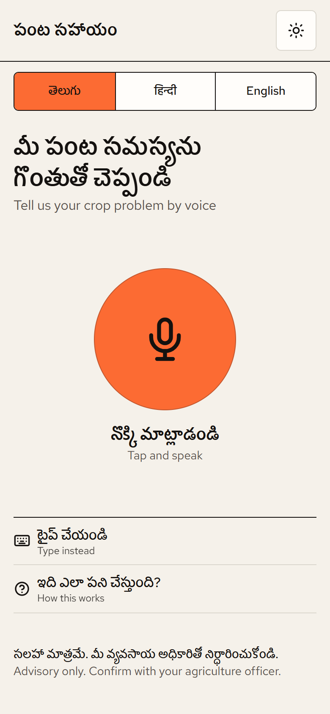&nbsp;
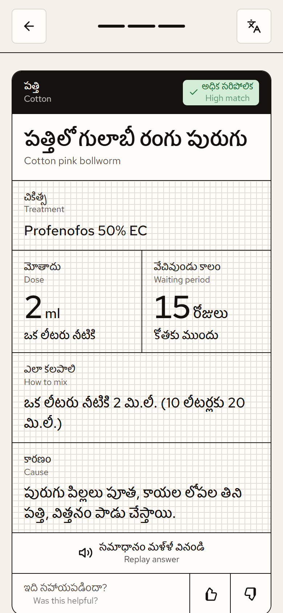&nbsp;
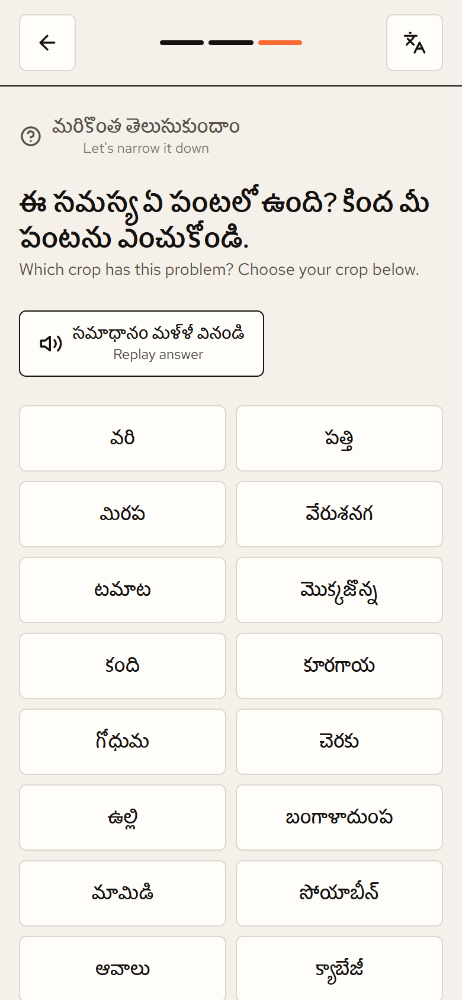&nbsp;
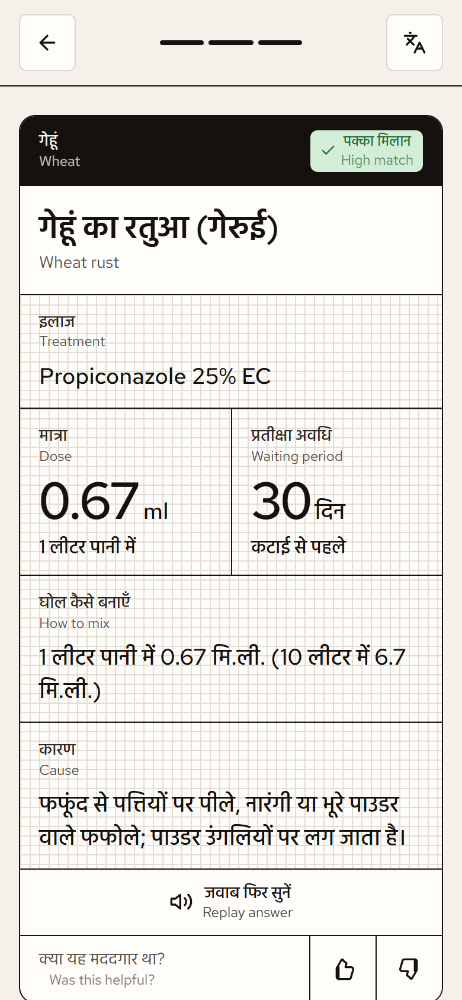

<sub>Real screenshots of the running app on a phone (390 × 844).</sub>

</div>

---

## 📖 Contents
[The problem](#-the-problem) · [What it does](#-what-it-does) · [How it works](#-how-it-works) · [Screenshots](#-screenshots) · [Tech stack](#-tech-stack) · [Where the answers come from](#-where-the-answers-come-from) · [Architecture](#%EF%B8%8F-architecture) · [Run it](#-run-it-on-your-computer) · [Deploy](#-deploy) · [Configuration](#-configuration) · [API](#-api) · [Project structure](#%EF%B8%8F-project-structure) · [Updating the knowledge](#-updating-the-knowledge) · [Tests](#-tests-and-checks) · [Roadmap](#%EF%B8%8F-roadmap-and-honest-limits)

---

## 🌱 The problem

When a pest or disease shows up, a small farmer in India usually has two options: guess, or ask the pesticide shop, which is also the one selling the spray. Wrong products, double doses and spraying just before harvest are common, and they cost money, harm health and leave residues on food.

Most farm apps are text-heavy, English-first and need an account. **Many farmers are more comfortable speaking than typing**, and they speak Telugu or Hindi.

## ✨ What it does

> **Press the mic → describe the problem in your own words → get the answer spoken back in your language.**

- 🎙️ **Voice first, no login, no install.** Open the link and tap the microphone. Speak for up to 30 seconds. Typing works too.
- 🗣️ **Telugu, Hindi and English.** Speech-to-text and voice come from **Gnani AI** models.
- 🔁 **Switch the language at any moment.** A small language key at the top right re-reads the same answer, text and voice, in another language. It works on the "You said" screen and on the answer.
- ✅ **A complete answer:**
  - the problem's name and cause;
  - the **product**, the **dose per litre** and how to mix 10 litres;
  - the **waiting period before harvest**, which follows the crop the farmer named.
- 📚 **Every dose checked against the government.** Each treatment is matched to its row in the official **CIB&RC "Major Uses of Pesticides"** list, and an automatic audit fails the build if one drifts.
- 🧭 **No dead ends.** For a broad question like *"there are caterpillars on my plant, what do I do?"*, the app asks **which crop**, then shows that crop's caterpillar problems as buttons, then answers.
- 🧪 **Other registered sprays.** When the crop is known, the answer also lists other products registered for that crop and pest, each linked to its page in the official PDF.
- 🛡️ **Safe by design:**
  - it **never invents a product or a dose**;
  - it shows a "Draft advice: confirm with an officer" note until an agriculture officer verifies an entry;
  - it offers the **Kisan Call Centre (1800-180-1551)** when it can't help.
- 📱 **Phone, tablet and laptop.** Large touch targets, plus a bright mode for reading in sunlight.

## 🔄 How it works

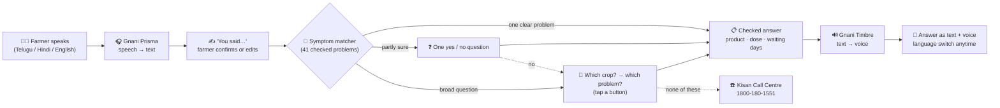

1. **Listen.** The phone records the farmer and converts the audio to 16 kHz mono WAV in the browser. **Gnani Prisma** turns it into text.
2. **Confirm.** The farmer sees *"You said: …"* and can edit it or record again. A mis-heard word never turns into a wrong spray.
3. **Understand.** A transparent, rule-based **symptom matcher** scores every known problem:
   - it counts the symptom words heard, in all three languages;
   - it adds points when the crop matches and takes them away when it doesn't;
   - it tolerates English speech slips such as *"bowl worm"* for *bollworm*.
4. **Decide.**
   - **Strong match:** answer.
   - **Partial match:** one yes/no question.
   - **Broad question:** guided crop and problem choices.
   - **Nothing fits:** the officer.
5. **Answer.** The reply is built **only** from the checked entry, never generated freely. **Gnani Timbre** speaks it.

## 📸 Screenshots

### 📱 Phone

| Home | Answer (Telugu) | Broad question → choose crop | Language switch | Answer (Hindi) |
|:---:|:---:|:---:|:---:|:---:|
|  |  |  | 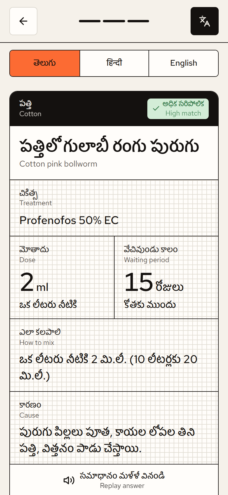 |  |

<details>
<summary>Full-length phone answers (scroll)</summary>

| Cotton pink bollworm · Telugu | Wheat rust · Hindi | Choose your crop · Telugu |
|:---:|:---:|:---:|
| 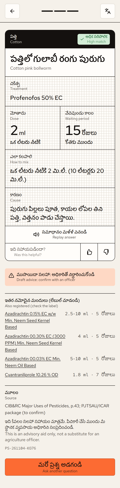 | 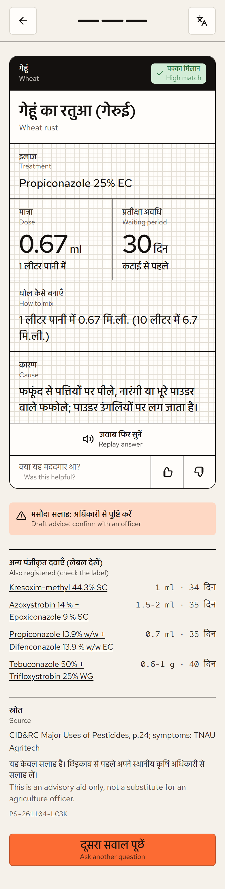 | 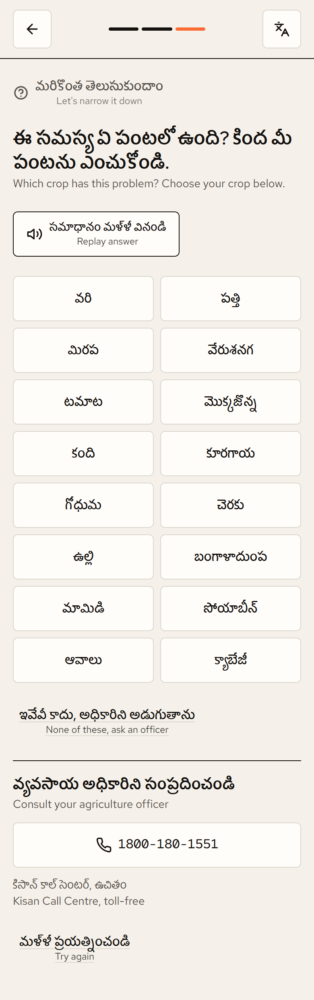 |

</details>

### 💻 Desktop

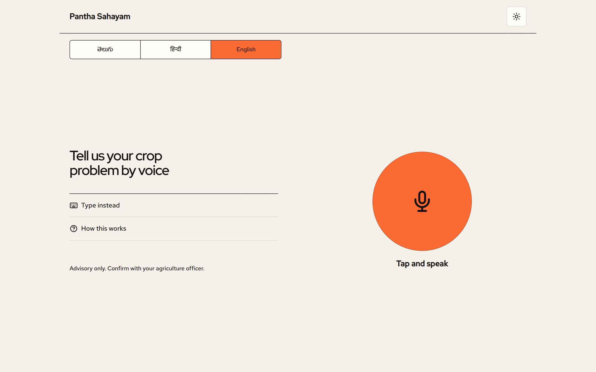

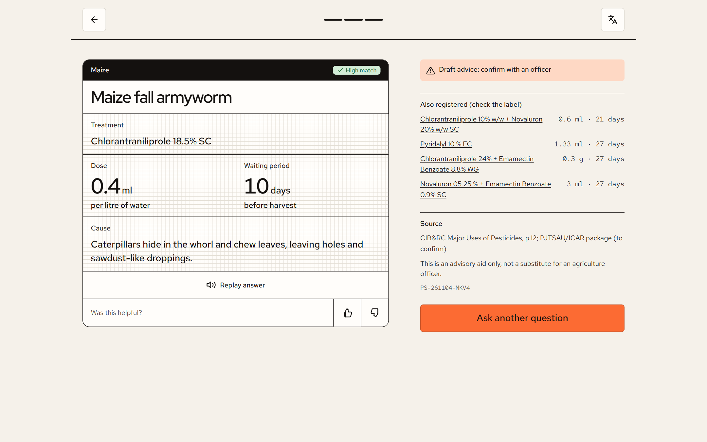

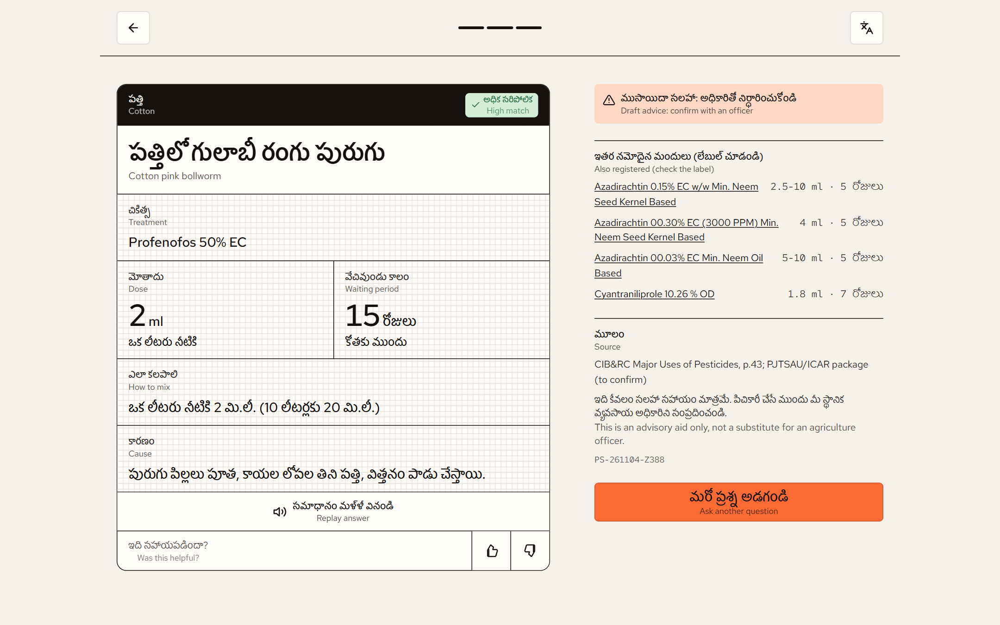

## 🧰 Tech stack

### 🧠 AI: Gnani models (the heart of the app)

| Model | What it does here | How it's used |
|---|---|---|
| **Gnani Prisma v2.5** (speech-to-text) | Turns the farmer's spoken Telugu, Hindi or English into text | `POST /stt/v3` on `api.vachana.ai`. The browser records up to 30 s, converts it to 16 kHz mono WAV and the server sends it with the language code (`te-IN`, `hi-IN`, `en-IN`). |
| **Gnani Timbre v3.0** (text-to-speech, voice *Lakshmi*) | Speaks every answer, follow-up question and choice prompt in the farmer's language | `POST /api/v1/tts/inference`. The WAV comes back base64-encoded with the answer and plays at once. Timbre v2.5 (voices Lavanya, Nalini, Kaveri) is one setting away. |

Gnani is called only from the server, so the API key never reaches the phone. One automatic retry on rate limits or temporary errors keeps the flow smooth, and every error type Gnani returns is read and reported clearly.

### ⚙️ Backend: Python

| Technology | Role |
|---|---|
| **Python 3.12** | Language for the API, the matcher and the data tools |
| **Flask 3** | The HTTP API (`/api/advise`, `/api/answer`, `/api/feedback`, `/api/health`). It also serves the built React app, so one server runs everything. |
| **Waitress** | Production WSGI server (multi-threaded, works the same on Windows and Linux) |
| **SQLite** (`pesticides.db`) | The **official pesticide registry**: 2,243 registered uses (crop · pest · product · dose · water · waiting period · source page). Read-only, a single file, no database server. |
| **JSON knowledge base** | 41 hand-checked problems with symptoms in three languages, causes, follow-up questions and treatments |
| **Rule-based symptom matcher** | Explainable scoring, with no black box choosing a diagnosis. Unicode normalisation (NFC, Telugu and Devanagari digits) plus fuzzy matching for English speech slips. |
| **requests · python-dotenv · flask-cors** | Gnani HTTP calls, `.env` settings and a CORS allow-list |
| **PyMuPDF** *(developer tool only)* | Reads the official CIB&RC PDFs table by table to build `pesticides.db` |

Also built in:
- a per-device **rate limit**, to protect Gnani credits;
- a **text-length guard**;
- a **pilot log** (JSONL) that records every consultation and rating, with a reference code (e.g. `PS-261104-K7M2`) on every answer, and `pilot_report.py` to summarise it;
- a **`BLOCK_UNVERIFIED`** safety switch for field pilots.

### 🎨 Frontend: React

| Technology | Role |
|---|---|
| **React 18** | The five farmer screens (Home → Listening → You said → Answer / Choices) as one state machine. Browser back-button support included. |
| **Vite 5** | Dev server and production build (~57 kB of JavaScript after gzip) |
| **MediaRecorder + Web Audio API** | Records the voice, shows a live microphone level meter, detects silence or too-short clips, and converts the audio to **16 kHz mono WAV** in the browser (`wav.js`) |
| **Web Speech API** | Fallback recognition and voice when Gnani is unavailable or switched off for development |
| **Hand-written CSS with design tokens** | No UI framework. Colour, spacing and type tokens, 44 px+ touch targets, a sunlight mode, and layouts for phone, tablet and a two-column desktop. |
| **Red Hat Display / Text + Hind Guntur + Hind** (Google Fonts) | Clean Latin type, plus fonts that render Telugu and Devanagari (Hindi) script properly |
| **Inline SVG icons** | Lightweight, colour-aware icons with no icon library |

Every label is **bilingual**: the chosen language first, with English underneath. Help reaches farmers who read only their own language, and judges or officers can still follow along.

### 📊 Data sources

| Source | Used for |
|---|---|
| **CIB&RC, *Major Uses of Pesticides*** (Central Insecticide Board & Registration Committee, Govt. of India, ppqs.gov.in, as on 30.09.2026) | Every product, dose and waiting period, plus the whole `pesticides.db` (insecticides, fungicides, bio-insecticides, bio-fungicides) |
| **TNAU Agritech Portal** (Tamil Nadu Agricultural University) | Symptom descriptions of pests and diseases |
| **Kisan Call Centre** (1800-180-1551) | Fallback when the app can't help |

### 🚢 DevOps and quality

| Tool | Role |
|---|---|
| **Docker** (multi-stage) | Stage 1: Node 20 builds the React app. Stage 2: Python 3.12 serves the app and the API. One image, one port. |
| **Vercel Container runtime / Render Blueprint** | The same Dockerfile deploys on Vercel (zero config) or Render (`render.yaml`, health check on `/api/health`) |
| **pytest** (45 tests) | Matcher, answers in all three languages, the Gnani request and response shapes, language switching, guided choices, safety switches, rate limits, and the registry audit |
| **`audit_kb.py`** | Checks every treatment in the app against the official rows. It runs inside the test suite, so a wrong dose fails the build. |

## 📚 Where the answers come from

The app **does not let an AI write farm advice.** A large language model can sound confident and still invent a dose, and on a farm that means harm. Instead:

1. **41 problems on 16 crops**, each written by hand:
   - **Crops:** rice, cotton, chilli, groundnut, tomato, maize, pulses, vegetables, wheat, sugarcane, onion, potato, mango, soybean, mustard, cabbage.
   - **Each entry has:**
     - the symptom words farmers actually use, in Telugu, Hindi and English;
     - the cause;
     - a follow-up question;
     - the treatment.
2. **Each treatment comes from one row of the government list**, and that row is cited with the PDF and page number.
3. **`audit_kb.py` re-checks every entry** against `pesticides.db`: the product must be registered for that crop and pest, the dose must sit inside the official range, and the waiting period must not be shorter than the official one. It already caught two real mistakes during development. One was a mancozeb formulation that isn't registered for tomato early blight; the other was a neem product that isn't registered against aphids.
4. **Waiting periods follow the crop.** Chlorantraniliprole needs 3 days on tomato but 29 on pigeon pea. If the crop is unknown, the app uses the longest one.
5. **The answer text is a fixed template** filled only from the entry. A number guard rejects any phrasing that adds or drops a figure.
6. **Human sign-off:** every entry carries `verified: false` and the app says *"Draft advice"* until an agriculture officer checks it. With `BLOCK_UNVERIFIED=1`, unverified entries go to the officer instead.

## 🏗️ Architecture

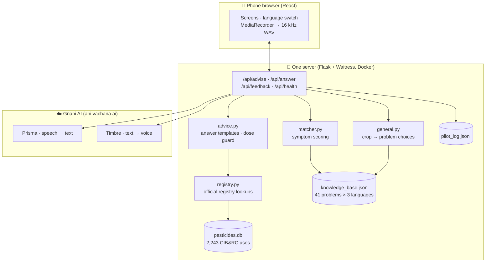

## 💻 Run it on your computer

**Needs:** Python 3.12+, Node 20+, and a Gnani API key from [app.gnani.ai](https://app.gnani.ai/voice).

```bash
# 1. Backend
cd backend
python -m venv .venv
.venv\Scripts\pip install -r requirements.txt        # macOS/Linux: .venv/bin/pip
copy .env.example .env                                # macOS/Linux: cp .env.example .env
#    open backend/.env and paste your key after GNANI_API_KEY=
.venv\Scripts\python -m pytest                        # 45 tests

# 2. Frontend
cd ../frontend
npm install
npm run build                                         # creates frontend/dist

# 3. Run the whole app (app + API on one port)
cd ../backend
.venv\Scripts\python serve.py                         # → http://localhost:5000
```

For frontend development with hot reload, run `npm run dev` in `frontend/` (http://localhost:5173) next to `python app.py`.
No Gnani key yet? Set `GNANI_MOCK=1`: the app then uses typed text or the browser's own speech, and skips the voice.

> 📱 **Testing on a phone:** browsers only allow the microphone over **https** (or on `localhost`). Use the deployed link, or a tunnel such as `cloudflared` or `ngrok`.

## 🚀 Deploy

The whole app (React screens + Python API) is **one Docker image**, so it deploys as **one service on one link**. You never host the frontend and backend separately.

**Vercel**
1. [vercel.com](https://vercel.com) → **Add New → Project** → import this GitHub repository.
2. Vercel finds the root `Dockerfile` and picks the **Container** preset (Container runtime, in beta on all plans). Leave the build settings as they are.
3. Under **Environment Variables**, add:
   - `GNANI_API_KEY` = your key (secret, never in the code);
   - `GNANI_TTS_MODEL` = `timbre-v3.0`.
4. **Deploy.** You get an `https://….vercel.app` link where the microphone works on phones.

**Render**
1. [render.com](https://render.com) → **New → Blueprint** → choose this repository. It reads [`render.yaml`](render.yaml).
2. Paste your **`GNANI_API_KEY`** when asked.
3. **Deploy.** You get an `https://….onrender.com` link.

**Any Docker host** (Railway, Fly.io, a VPS):
```bash
docker build -t pantha-sahayam .
docker run -p 8000:80 -e GNANI_API_KEY=your-key -e GNANI_TTS_MODEL=timbre-v3.0 -v pantha-data:/data pantha-sahayam
```
The image listens on port 80, or on `$PORT` if the host sets one. The volume on `/data` keeps the pilot log across restarts. On hosts without a persistent disk, the pilot log is temporary, and the app keeps answering even if it can't write the log.

## 🔧 Configuration

All settings are environment variables (or `backend/.env` locally). See [`backend/.env.example`](backend/.env.example).

| Setting | Default | Purpose |
|---|---|---|
| `GNANI_API_KEY` | — | Your Gnani key (**secret, never commit it**) |
| `GNANI_BASE_URL` | `https://api.vachana.ai` | Gnani API address |
| `GNANI_STT_MODEL` | *(Prisma v2.5)* | Or `prisma-v3.0` |
| `GNANI_TTS_MODEL` | `timbre-v2.5` | `timbre-v3.0` (voice Lakshmi) is recommended and set in `render.yaml` |
| `GNANI_TTS_VOICE` | *(per language)* | Force one voice for every language |
| `GNANI_MOCK` | `0` | `1` = no Gnani calls (development) |
| `BLOCK_UNVERIFIED` | `0` | `1` during a farmer pilot: unverified entries go to the officer |
| `RATE_LIMIT_PER_MIN` | `20` | Questions per minute per device (protects credits) |
| `TRUST_PROXY` | `0` | `1` behind a host or proxy, so each farmer is rate-limited separately |
| `ALLOWED_ORIGINS` | localhost:5173 | Browser origins allowed to call the API in development |
| `PILOT_LOG_PATH` | `pilot_log.jsonl` | Where consultations are logged |
| `PORT` | `5000` | Server port (hosts set this automatically) |

## 🔌 API

| Endpoint | Body | Returns |
|---|---|---|
| `POST /api/advise` | multipart: `audio` (WAV) **or** `text`, `lang` (`te`/`hi`/`en`), plus optional `context`, `confirm_id`, `crop` and `guide` | The transcript plus one of: an answer (`strong`), a yes/no question (`followup`), crop/problem `choices`, or `escalate`. Each comes with Gnani voice (`audio_base64`) and a reference code. |
| `POST /api/answer` | JSON: `kind`, `matched_id`, `crop`, `lang`, `ref` | The **same answer in another language**, with new voice |
| `POST /api/feedback` | JSON: `ref`, `useful`, `lang` | Logs the helpful / not-helpful rating |
| `GET /api/health` | — | Status, number of entries, whether Gnani is configured, and the voice languages |

## 🗂️ Project structure

```
Farmer-app/
├── backend/
│   ├── app.py                 # Flask API + serves the built React app
│   ├── serve.py               # production server (Waitress)
│   ├── gnani.py               # Gnani Prisma (STT) + Timbre (TTS) client
│   ├── matcher.py             # rule-based symptom matcher
│   ├── general.py             # broad questions → crop → problem choices
│   ├── advice.py              # answer templates in 3 languages, dose guard, safety switch
│   ├── registry.py            # reads the official registry (pesticides.db)
│   ├── audit_kb.py            # checks every treatment against official rows
│   ├── knowledge_base.json    # 41 checked problems · 16 crops · 3 languages
│   ├── pesticides.db          # 2,243 CIB&RC registered uses (SQLite)
│   ├── pilot_report.py        # summary of a farmer pilot
│   ├── tools/build_pesticide_db.py   # rebuilds pesticides.db from the official PDFs
│   └── tests/                 # 45 pytest tests
├── frontend/
│   ├── src/App.jsx            # screens and flow
│   ├── src/strings.js         # all interface text (Telugu · Hindi · English)
│   ├── src/wav.js             # browser audio → 16 kHz WAV
│   ├── src/styles.css · tokens.css · base.css
│   └── index.html
├── docs/screenshots/          # images used in this README
├── Dockerfile                 # one image: React build + Python server
├── render.yaml                # one-click Render deploy (Vercel needs no config file)
└── README.md
```

## 🔄 Updating the knowledge

The app answers what its data covers, and the data is meant to grow:

- **Add a problem:**
  1. Add an entry to `backend/knowledge_base.json` (symptoms in three languages, cause, follow-up question, treatment from an official row).
  2. Run `python audit_kb.py` and `pytest`.
  3. Push. The host redeploys automatically.
- **Refresh the official registry:** run `python tools/build_pesticide_db.py` (needs `pip install -r requirements-dev.txt`). It downloads the latest CIB&RC lists and rebuilds `pesticides.db`. Then `audit_kb.py` shows exactly which answers changed.
- **Know what to add:** `python pilot_report.py` shows what farmers asked, including questions that ended at "none of these".

## 🧪 Tests and checks

```bash
cd backend
.venv\Scripts\python -m pytest -q      # 45 passed
.venv\Scripts\python audit_kb.py       # 0 problem(s)
```
The tests cover:
- matching in Telugu, Hindi and English, including real Gnani mishearings;
- answers and dose strings in all three languages;
- the Gnani request and response formats and error handling, without spending credits;
- language switching, the guided crop and problem choices, and the safety switches;
- rate limits and serving the app;
- and the official-registry audit.

## 🗺️ Roadmap and honest limits

- **Coverage:** answers come only from the 41 checked problems. Outside them, the app guides the farmer to the Kisan Call Centre instead of guessing. The pilot log shows what to add next.
- **Expert sign-off:** entries are marked *draft* until an agriculture officer verifies them, and native speakers should review the Telugu and Hindi wording.
- **Field testing:** the next step is real recordings from farmers in noisy fields, to tune the matcher.
- **Next features:** mandi crop prices (Agmarknet), more crops and problems, and an officer dashboard.

> ⚠️ **Advisory only.** Pantha Sahayam helps farmers reach the right, registered treatment. It does not replace an agriculture officer, and the product label is always final.

## 🙏 Acknowledgements

- **[Gnani AI](https://gnani.ai)** for the Prisma and Timbre speech models, and the Great Indian AI Internship Challenge
- **CIB&RC, Directorate of Plant Protection, Quarantine & Storage** for the public *Major Uses of Pesticides* lists
- **TNAU Agritech Portal** for open crop-protection knowledge
- **Kisan Call Centre** for a free helpline that every Indian farmer can call

<div align="center">

**Made with care for the farmers who feed us. 🌾**

`#GnaniAI` `#GreatIndianAIInternshipChallenge`

</div>
